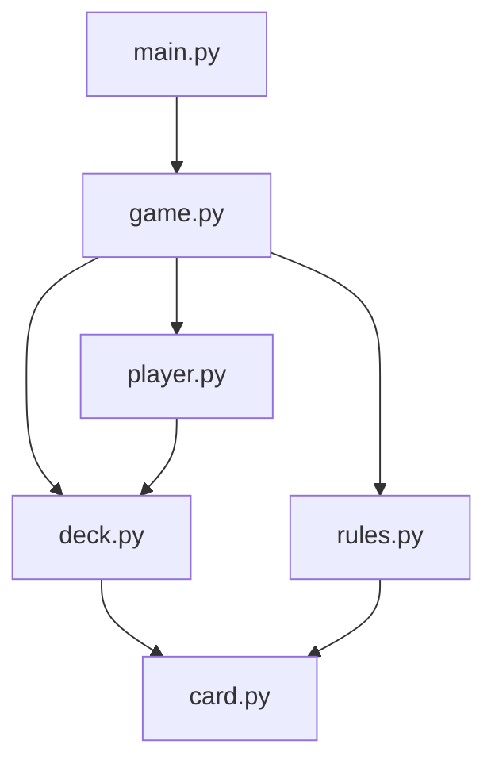

# Uno 游戏设计文档

在 UNO 游戏中，合理的 **函数设计** 和 **模块间引用** 对代码的可维护性和扩展性至关重要。以下是结合 UNO 核心玩法的模块化设计建议，包括关键函数定义和模块交互方式：

---

## **1. 模块职责划分与函数设计**

### **（1）`card.py` —— 卡牌基础定义**

```python
class Card:
    def __init__(self, color: str, value: str):
        self.color = color  # "Red", "Green", "Blue", "Yellow", "Black"(万能牌)
        self.value = value  # "0"-"9", "Skip", "Reverse", "Draw2", "Wild", "Wild+4"

    def __repr__(self):
        return f"Card({self.color}, {self.value})"

    def is_wild(self) -> bool:
        """检查是否为万能牌"""
        return self.color == "Black"
```

### **（2）`deck.py` —— 牌堆管理**

```python
class Deck:
    def __init__(self):
        self.draw_pile = self._generate_cards()  # 抽牌堆
        self.discard_pile = []                   # 弃牌堆
        self.shuffle()

    def _generate_cards(self) -> List[Card]:
        """生成108张牌（略，见前文）"""

    def draw(self, n: int = 1) -> List[Card]:
        """抽n张牌，自动处理牌堆不足时的重置逻辑"""

    def discard(self, card: Card):
        """将牌放入弃牌堆顶部"""

    def reshuffle_discard_pile(self):
        """用弃牌堆（除顶部牌外）重置抽牌堆"""
```

### **（3）`player.py` —— 玩家行为**

```python
class Player:
    def __init__(self, name: str):
        self.name = name
        self.hand: List[Card] = []

    def play_card(self, card_idx: int) -> Card:
        """尝试出牌，返回被出的牌"""
        return self.hand.pop(card_idx)

    def draw_cards(self, deck: Deck, n: int):
        """从牌堆抽n张牌"""
        self.hand.extend(deck.draw(n))
```

### **（4）`rules.py` —— 规则验证**

```python
class Rules:
    @staticmethod
    def is_valid_play(card: Card, top_card: Card, current_color: str) -> bool:
        """检查出牌是否合法（颜色/数字/功能匹配）"""

    @staticmethod
    def check_win(player: Player) -> bool:
        """检查玩家是否获胜（手牌为空）"""

    @staticmethod
    def apply_special_effect(card: Card, game: 'Game'):
        """处理特殊牌效果（如跳过、反转、罚牌）"""
```

### **（5）`game.py` —— 游戏主逻辑**

```python
class Game:
    def __init__(self, player_names: List[str]):
        self.players = [Player(name) for name in player_names]
        self.deck = Deck()
        self.current_player_idx = 0
        self.direction = 1  # 游戏方向: 1=顺时针, -1=逆时针
        self.current_color = None  # 当前有效颜色（万能牌指定后更新）

    def start(self):
        """初始化游戏：发牌、设置起始弃牌"""
        self._deal_cards()
        initial_card = self.deck.draw(1)[0]
        self.deck.discard(initial_card)
        self.current_color = initial_card.color

    def play_turn(self, player: Player, card_idx: int):
        """处理玩家回合：出牌、触发规则、切换回合"""
        card = player.play_card(card_idx)
        self.deck.discard(card)
        Rules.apply_special_effect(card, self)
        self._next_player()
```

### **（6）`main.py` —— 程序入口与交互**

```python
from uno.game import Game

def main():
    game = Game(["Alice", "Bob"])
    game.start()

    while True:
        current_player = game.get_current_player()
        print(f"当前玩家: {current_player.name}")
        print(f"弃牌堆顶: {game.deck.discard_pile[-1]}")

        # 玩家选择出牌或抽牌
        action = input("出牌(输入牌索引)或抽牌(draw): ")
        if action == "draw":
            current_player.draw_cards(game.deck, 1)
        else:
            game.play_turn(current_player, int(action))

        if Rules.check_win(current_player):
            print(f"{current_player.name} 获胜！")
            break
```

---

## **2. 模块间引用关系**

### **依赖流程图**



### **关键引用说明**

1. **`main.py` 仅依赖 `game.py`**  
   - 负责启动游戏，不直接操作其他模块。

2. **`game.py` 是核心枢纽**  
   - 聚合 `Player`、`Deck`、`Rules`，协调游戏流程。

3. **`rules.py` 单向依赖**  
   - 只引用 `Card` 和 `Game`，避免循环依赖。

4. **`player.py` 仅依赖 `deck.py`**  
   - 玩家行为只需抽牌，不关心游戏规则。

---

## **3. 函数设计原则**

### **（1）单一职责**

- 每个函数只做一件事，例如：
  - `Deck.draw()` 只负责抽牌。
  - `Rules.is_valid_play()` 只验证规则。

### **（2）明确输入输出**

- 使用类型注解（如 `def draw(n: int) -> List[Card]`）提升可读性。

### **（3）减少跨模块状态修改**

- 例如 `Player.draw_cards()` 通过 `Deck.draw()` 获取牌，而非直接操作 `deck.draw_pile`。

### **（4）依赖注入**

- `Game` 类通过构造函数接收玩家列表，而非在内部硬编码：

  ```python
  # 好设计：可灵活扩展玩家数量
  game = Game(["Alice", "Bob", "Charlie"])
  ```

---

## **4. 处理特殊游戏场景的函数**

### **（1）万能牌颜色选择**

```python
# game.py
class Game:
    def choose_color(self, color: str):
        """玩家打出万能牌后选择颜色"""
        if color not in {"Red", "Green", "Blue", "Yellow"}:
            raise ValueError("非法颜色")
        self.current_color = color
```

### **（2）回合跳过与反转**

```python
# rules.py
class Rules:
    @staticmethod
    def apply_special_effect(card: Card, game: 'Game'):
        if card.value == "Skip":
            game._next_player()  # 跳过下家
        elif card.value == "Reverse":
            game.direction *= -1  # 反转方向
```

### **（3）罚牌逻辑**

```python
# game.py
class Game:
    def penalize_next_player(self, n: int):
        """下家抽n张牌"""
        next_player = self.get_next_player()
        next_player.draw_cards(self.deck, n)
        self._next_player()  # 跳过被罚玩家的回合
```

---

## **5. 测试与调试建议**

1. **单元测试重点模块**  
   - 测试 `Rules.is_valid_play()` 的边界条件（如万能牌、颜色匹配）。
   - 验证 `Deck.draw()` 在牌堆耗尽时的行为。

2. **Mock 依赖**  
   - 测试 `Game` 时，用 Mock 对象模拟 `Player` 和 `Deck`。

3. **日志记录**  
   - 在 `utils.py` 中添加日志函数，跟踪游戏状态变化：

     ```python
     def log_game_state(game: Game):
         print(f"当前玩家: {game.current_player.name}, 方向: {game.direction}")
     ```

---

## **总结**

- **模块化**：按功能划分模块，避免“上帝对象”。
- **低耦合**：通过接口交互（如 `Deck.draw()`），而非直接操作内部状态。
- **高内聚**：相关函数集中到同一模块（如所有规则在 `rules.py`）。
- **可扩展性**：支持未来新增功能（如 AI 玩家、网络对战）。

通过这种设计，UNO 游戏可以轻松扩展新规则或交互方式，同时保持代码清晰。
